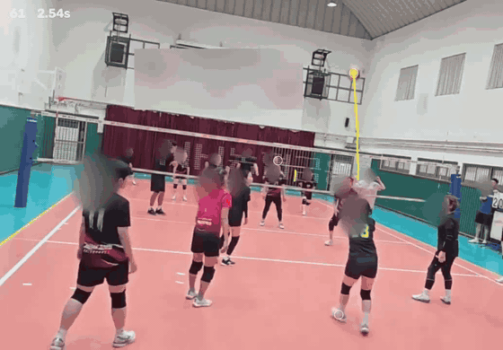

# WeavePlay

**Volleyball Video Intelligence**

한 대의 카메라로 촬영한 생활체육 배구 영상을  
경기 흐름과 플레이의 맥락을 읽을 수 있는 데이터로.

Computer Vision · Video Understanding · Sports AI

---

## Prototype Preview

  

Early research prototype · Experimental candidate visualization

위 화면은 초기 프로토타입이 생성한 **분석 후보를 시각화한 장면**입니다. 검증된 자동 판정 결과나 제품의 최종 정확도를 의미하지는 않습니다.

## Overview

생활체육 경기 영상은 쉽게 촬영할 수 있지만, 필요한 장면을 찾고 플레이를 복기하는 과정은 여전히 번거롭습니다.

**WeavePlay**는 일반적인 촬영 환경의 배구 영상에서 의미 있는 움직임과 경기 이벤트를 이해하는 컴퓨터 비전 연구 프로젝트입니다. 기록된 영상을 단순히 재생하는 데서 나아가, 플레이 단위로 탐색하고 해석할 수 있는 기반을 만드는 것을 목표로 합니다.

## Research Focus

| Focus | What we're exploring |
| :--- | :--- |
| **Motion Understanding** | 빠르게 움직이는 공과 선수의 움직임을 영상 속에서 해석합니다. |
| **Play Event Recognition** | 플레이 전개에 중요한 순간과 이벤트를 식별하는 방법을 연구합니다. |
| **Match Structure** | 긴 경기 영상을 랠리와 플레이의 흐름으로 구조화합니다. |
| **Reviewable Analysis** | 분석 결과를 사람이 검토하고 수정할 수 있는 경험을 설계합니다. |

## Engineering Challenges

실제 동호회 영상은 방송 중계 영상과 다릅니다. 촬영 위치가 일정하지 않고, 빠른 공의 움직임과 선수 사이의 가림 현상도 빈번합니다. WeavePlay는 이러한 환경에서 동작하는 영상 이해 기술과 검증 가능한 분석 경험에 집중합니다.

## Current Status

**Research prototype · Active development**

- **구현:** 초기 영상 분석 후보 생성 및 시각화, 프레임 단위 검토 도구
- **진행 중:** 실제 생활체육 영상 기반의 데이터 구축 및 분석 품질 검증
- **연구 방향:** 경기 이벤트 이해와 플레이 단위 탐색 경험의 고도화

정량 성능은 충분한 독립 검증을 거친 결과만 선별적으로 공개할 예정입니다.

---

### Repository Scope

이 저장소는 WeavePlay의 **공개 프로젝트 소개 및 일부 시연 자료**를 위한 공간입니다. 연구·개발에 사용되는 소스 코드, 데이터셋, 모델 가중치, 내부 설계 및 실험 기록은 공개하지 않습니다.

Public research showcase · Not an open-source release
